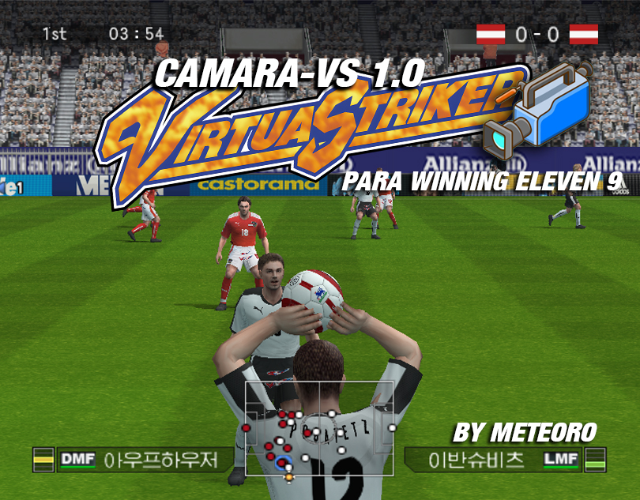
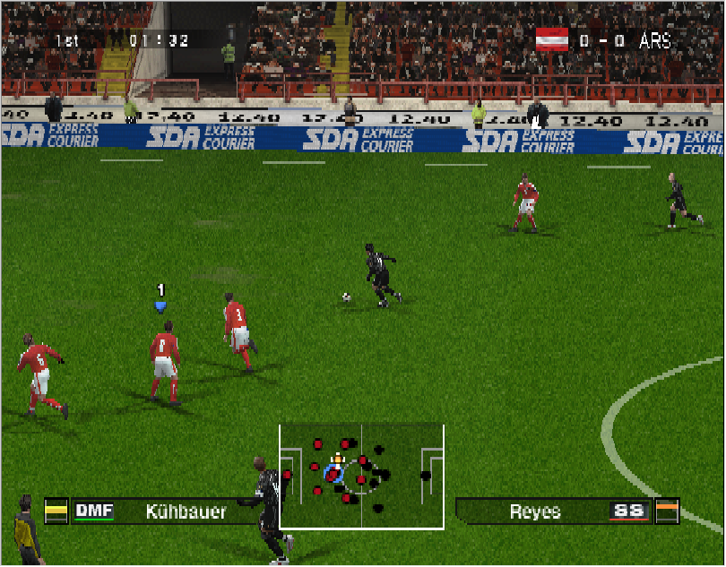
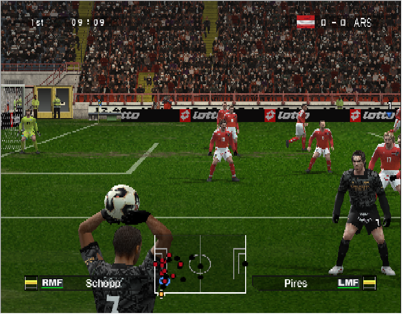
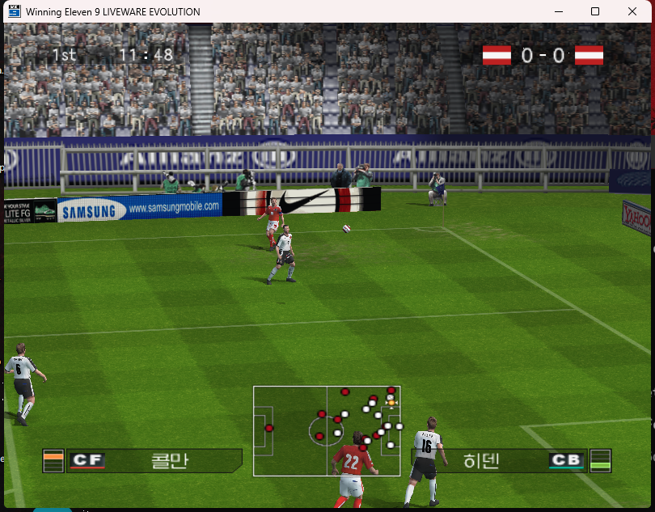
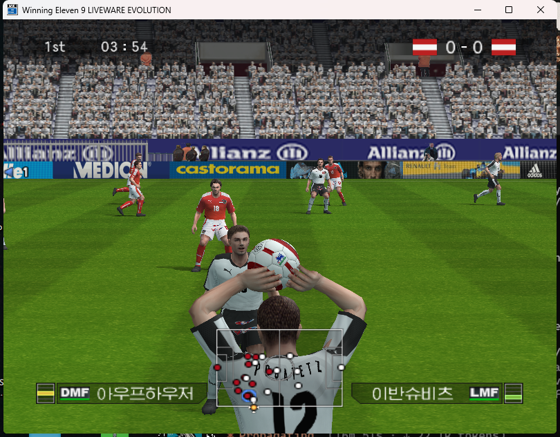
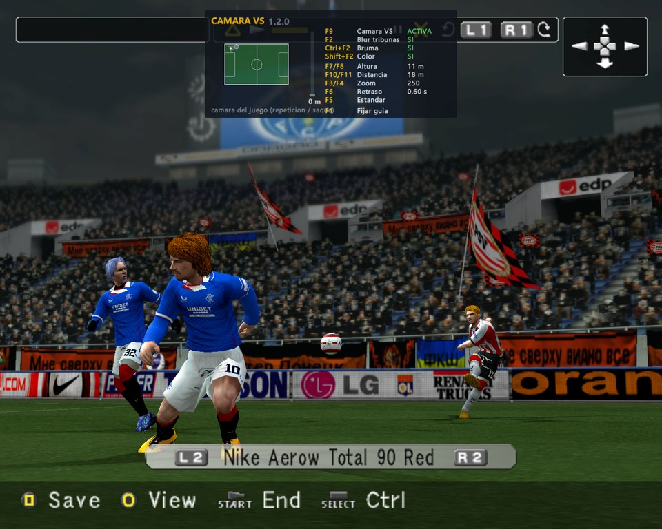
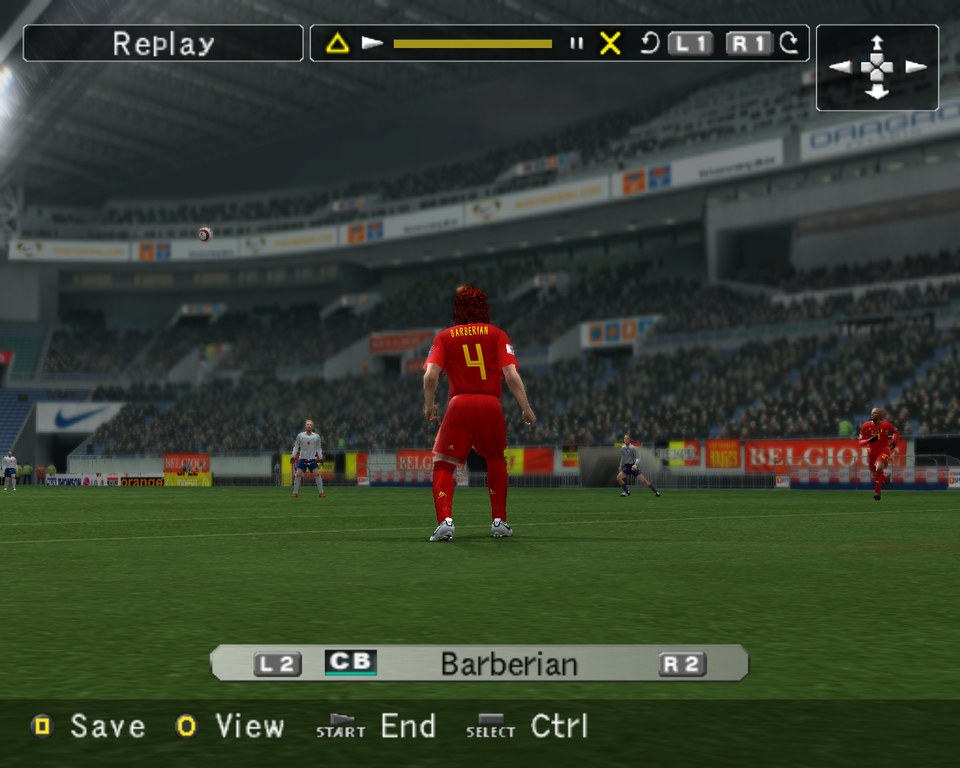

# Cámara VS



**Cámara de juego estilo Virtua Striker para Winning Eleven 9 y Winning Eleven 9 Liveware Evolution (PC).**
Módulo gratuito para **Kitserver 5**. Hecho por y para la comunidad WE9.
Desde la 1.2 suma el **blur de tribunas** de los arcades de Sega, bruma, color y una guía en pantalla.

*English summary below.*

| WE9 — juego | WE9 — lateral |
|---|---|
|  |  |
| **WE9LE — juego (giro cerca del arco)** | **WE9LE — lateral** |
|  |  |
| **1.2 — blur de tribunas y guía en pantalla** | **1.2 — blur en un estadio de noche** |
|  |  |

## Qué hace

- **Sigue a la pelota** desde un riel detrás de la línea de costado, a altura fija, como la transmisión de Virtua Striker 4: travelling suave, con un poco de anticipación según hacia dónde va la pelota.
- **Giro steadycam:** cerca de los arcos la cámara gira un poco hacia el centro, y mientras el mismo jugador conserva la pelota se va acomodando de frente.
- **Zoom compensado:** los jugadores se ven de un tamaño parecido en toda la cancha.
- **Laterales en tercera persona** del lado de la cámara, a la altura del hombro del que saca; los del lado de enfrente, con la toma de siempre.
- **Disparos y centros:** la cámara acompaña la trayectoria adelantándose y abre el zoom. Los disparos se reconocen por la trayectoria (rápida y hacia el arco), así los pases fuertes no los activan.
- **Arquero:** con la pelota en sus manos y en los saques de arco queda la cámara del juego. Lo mismo en repeticiones, festejos, presentación y entretiempo.
- **Estadio completo:** el juego apaga el cielo y oculta tribunas según hacia dónde mira *su* cámara (que siempre mira hacia abajo). Con la cámara VS activa eso se desactiva, así no queda negro arriba de las tribunas.
- No toca ningún archivo del juego: todo pasa en memoria mientras jugás y se deshace al apagarla.

### Efectos (1.2)

Funcionan con o sin la cámara VS activa, y con los estadios del juego o los de Kitserver.

- **Blur de tribunas estilo Virtua Striker**, anclado a las medidas reales de la cancha (105 × 68 m), no a la distancia de la cámara: del lado de enfrente empieza tenue 11 m adentro de la cancha, del lado de la cámara 2,5 m adentro y en los fondos 1 m antes de la línea de gol; crece hacia las tribunas en 6 anillos que se funden entre sí.
- **Bruma:** un velo de aire muy leve sobre las tribunas altas, con el color de niebla que el juego usa en cada estadio y horario.
- **Color:** saturación y contraste sutiles, solo en el mundo 3D.
- El marcador, los nombres y el resto del HUD quedan siempre nítidos y sin tocar.
- **Guía en pantalla** arriba al centro, entre los recuadros del marcador: esquema de la cancha con la cámara, hacia dónde mira y la pelota, y todas las teclas con sus valores.

## Instalación (Kitserver 5)

1. Bajá el `.zip` de la última versión en [Releases](../../releases).
2. Copiá **todo su contenido** dentro de la carpeta `kitserver` del juego (donde están `kload.cfg` y `kserv.dll`).
3. Ejecutá **`instalar.bat`**. Agrega la línea al `kload.cfg` y guarda un respaldo (`kload.cfg.antes-de-camara-vs`).
4. Jugá un partido: la cámara VS arranca activa.

Para sacarla: `desinstalar.bat` (o borrá la línea `camara_vs.dll` del `kload.cfg`).

<details>
<summary>Instalación a mano</summary>

En `kitserver\kload.cfg`, sumá una línea al final de la lista de módulos y aumentá `DLL.num` en uno:

```
DLL.num = 18
...
DLL.17 = "kitserver\camara_vs.dll"
```
</details>

<details>
<summary>Sin Kitserver</summary>

Con el juego abierto, ejecutá `inyectar.exe` (en la misma carpeta que `camara_vs.dll`): carga el módulo en el WE9/WE9LE que esté corriendo. Hay que hacerlo cada vez que abrís el juego. Algunos antivirus desconfían de los inyectores; si te molesta, usá Kitserver.
</details>

## Teclas (con la ventana del juego en foco)

| Tecla | Acción |
|---|---|
| **F9** | Activar / desactivar la cámara VS |
| F7 / F8 | Altura − / + 1 m |
| F10 / F11 | Distancia del riel − / + 2 m |
| F3 / F4 | Zoom más abierto / más cerrado |
| Av Pág / Re Pág | Giro steadycam hacia los arcos − / + (cerca: tercera persona; lejos: transmisión) |
| F6 | Suavidad del travelling (0,2 · 0,35 · 0,6 · 1 s) |
| F5 | Volver a la configuración estándar de Cámara VS |
| **F2** | Blur de tribunas: apagado → preset 1 → preset 2 |
| Insert | Bruma: apagada → preset 1 → preset 2 |
| Inicio | Color sí / no |
| Supr | Ver los anillos del blur en colores (para ajustar medidas) |
| **F1** | Fijar / ocultar la guía en pantalla (sola, aparece unos segundos al tocar cualquier tecla) |

Los ajustes se guardan solos en `camara_vs.ini`. Ahí también se pueden cambiar las teclas y otros valores: giro, anticipación y tiempo de acomodo de la cámara; en `[efectos]`, dónde empieza el blur de cada lado (en metros), cuánto se mezcla y qué tan ancho es en cada anillo, la bruma y el color.

## Compatibilidad

| Juego | Estado |
|---|---|
| Winning Eleven 9 (PC, `we9.exe`) | ✅ probado con Kitserver 5.7 |
| Winning Eleven 9 Liveware Evolution (PC, `WE9LEK.exe`) | ✅ probado con Kitserver 5.7 |
| Pro Evolution Soccer 5 (PC) | ❔ mismo motor que WE9, sin probar |
| Winning Eleven 7 / PES6 | 🔜 próximamente |

Todo se ubica **por firmas** (patrones de bytes) y no por direcciones fijas, así que debería andar también con exes parcheados. Si no encuentra algo, lo dice en `camara_vs.log` (junto a la DLL) y deja la cámara del juego.

Los efectos (blur, bruma, color y guía) necesitan **Kitserver** y andan tanto con la `d3d8.dll` de Windows como con **dgVoodoo**. Con `inyectar.exe`, sin Kitserver, solo funciona la cámara.

## Novedades 1.2.1

- **Segundo preset** de blur (entra más en la cancha y es más marcado) y de bruma (más baja y marcada): F2 / Insert una segunda vez.
- **Av Pág / Re Pág**: giro steadycam hacia los arcos; con la cámara cerca la lleva a espaldas de los jugadores, bien adentro de la cancha (tercera persona).
- **Teclas sin combinaciones**: bruma = Insert, color = Inicio, máscara = Supr (todas configurables).
- Soporte para **add-ons de público**: si hay un `publico_vs.dat` en la carpeta kitserver, el módulo recolorea el público con sus colores verdaderos (el juego lo tiñe de gris/azul en algunas tribunas). El add-on con gráficos no se distribuye acá.
- Arreglos: enganches que Kitserver toma antes (SetRenderState, SetTexture, texturas) y reutilización de direcciones de texturas.

## Novedades 1.2.0

- **Blur de tribunas** estilo Virtua Striker, **bruma** y **color**, con teclas propias (F2, Ctrl+F2, Shift+F2) e independientes de la cámara.
- **Guía en pantalla** (F1) con el esquema de la cancha, la cámara y todas las teclas.
- Laterales en tercera persona solo del lado de la cámara.
- Sin saltos cuando la pelota llega al pie (el adelanto de la cámara se suaviza).
- Disparos y centros: la cámara acompaña la trayectoria y abre el zoom; los pases ya no la aceleran.

## Novedades 1.1.0

- Movimiento **flotante tipo gimbal**: el travelling arranca y frena con suavidad, y la anticipación usa la velocidad filtrada de la pelota.
- Si la pelota se escapa del cuadro, el travelling acelera solo para alcanzarla.
- Ya no se invierte el ángulo en faltas ni en el saque del medio; cuando la pelota se recoloca, la cámara corta como en la TV.
- Giro lateral más leve cerca de los arcos.
- **F5** vuelve a la configuración estándar.

## Próximas versiones

- Tomas propias para córners y tiros libres.
- Estadio de Virtua Striker 4 como estadio de Kitserver.
- Port a **Winning Eleven 7** y **PES6**.

## Cómo funciona (para curiosos)

La cámara del juego vive en una estructura en memoria (ojo, objetivo, zoom, plano lejano). No se puede escribir ahí directamente: el director de cámaras del juego suaviza a partir de esos valores y terminaría "peleando" con la nuestra. Por eso el módulo envuelve la función que arma la matriz de vista: al entrar guarda la cámara del juego y pone la nuestra; al salir devuelve la del juego. El juego nunca ve nuestra cámara, solo la pantalla.

La pelota, la fase del partido (en juego / lateral / saque / falta...) y el último jugador que la tocó se leen de la memoria del juego. Ejes de WE9: `x` a lo largo de la cancha, `y` vertical (negativo = arriba), `z` a lo ancho; 256 unidades por metro en la física (la cancha mide exactamente 105 × 68 m) y 51,2 al dibujar.

**Efectos.** El módulo engancha el device Direct3D 8 del juego (hotpatch en la `d3d8.dll` de Windows, vtable en dgVoodoo). El juego dibuja el mundo en una textura y después el HUD con vértices ya transformados: justo antes del primer dibujo del HUD se arma una máscara con cajas invisibles del tamaño de la cancha dibujadas contra el depth buffer del juego (el stencil cuenta en cuántas cajas está cada píxel visible), se suaviza, y con ella se mezcla la escena achicada a 1/4 y 1/8. Todo con función fija, salvo el color, que es un pixel shader 1.4.

## Compilar

Hace falta **Visual Studio Build Tools** (C++). Ejecutá `build.bat`: deja `camara_vs.dll` e `inyectar.exe` en `dist\`. `empaquetar.bat` arma el `.zip` para publicar.

## Créditos

- Kitserver: juce y Robbie, y toda la gente de evo-web.
- Cámara VS: Matías ([@meteoro1983](https://github.com/meteoro1983)), con Claude.

Licencia **MIT**: usalo, modificalo y compartilo libremente.

---

## English summary

**Virtua Striker–style match camera for Winning Eleven 9 and WE9 Liveware Evolution (PC), as a free Kitserver 5 module.**
It follows the ball from a rail behind the touchline (like VS4), adds a gentle steadycam turn near the goals that recentres while a player keeps the ball, frames near-side throw-ins over the taker's shoulder, follows shots and crosses with a wider zoom, and keeps the game's own camera for goalkeeper restarts, replays and cut-scenes. It also stops the game from hiding the sky and stands, which it decides from its own camera.
**New in 1.2:** Sega-arcade style **stand blur** anchored to the real pitch size (105 × 68 m, works with stock and Kitserver stadiums), subtle **haze** and **colour grading** (3D world only, the HUD stays sharp), and an **on-screen guide**. F2 blur, Insert haze, Home colour, F1 guide, PgUp/PgDn goal-facing steadycam turn. Effects need Kitserver; they work with Windows' d3d8 and with dgVoodoo.

**Install:** copy the zip contents into the game's `kitserver` folder and run `instalar.bat` (it adds the module to `kload.cfg` and keeps a backup). **Keys:** F9 on/off, F7/F8 height, F10/F11 distance, F3/F4 zoom, F6 smoothing, F5 back to defaults, F2 / Insert / Home effects, PgDn/PgUp turn, F1 guide; settings are saved to `camara_vs.ini`. Everything is found by byte signatures, and problems are reported in `camara_vs.log`. MIT licensed.
